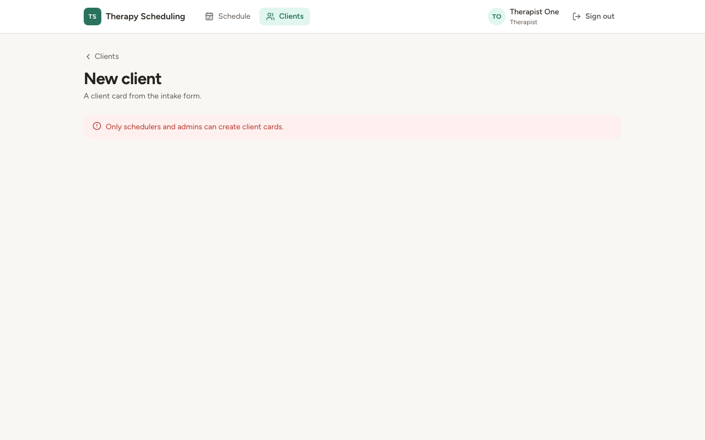
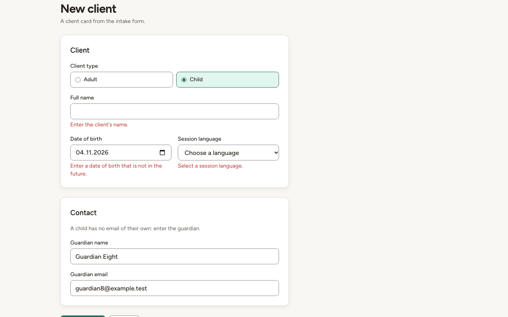
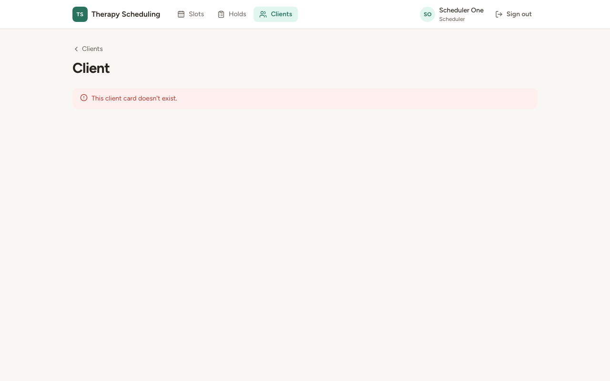
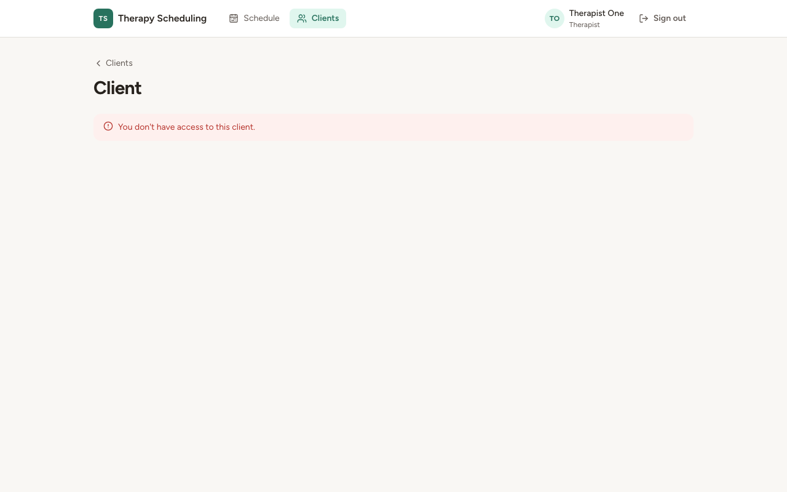

# Звіт UAT — 03.11.2026

- **Застосунок:** https://therapy-scheduling-theta.vercel.app (/api/health: коміт `f512871`)
- **Код тестів:** `task/uat-prod` @ `117f6ef`
- **Прогін:** 03.11.2026, 17:09 (Київ), Playwright 15.5 с; AC: 3 — PASS 3, FAIL 0, NEEDS-HUMAN 0
- **Рецензент:** `claude-haiku-5-5`; суперечки → `claude-sonnet-5-5`. Разом за розбір: $0.0063 (ціни API; за підпискою — у межах ліміту плану)
- **Прибирання:** синтетичних uat-*@example.test видалено 0, лишилось 0, їхніх рядків, що лишились: 0
- **Відео й траси:** не в git — `test-results/` локально або артефакт CI; трасу відкриває `npx playwright show-trace <trace.zip>`

| AC | Перевірки | Агент | Підсумок | Чому | Playwright | Розбір |
|---|---|---|---|---|---|---|
| AC-CARD-06 | пройшли | Haiku: PASS | **PASS** | R6: перевірки, агент і цитати збігаються | 2.3 с | $0.0019, 6.6 с |
| AC-CARD-12 | пройшли | Haiku: PASS | **PASS** | R6: перевірки, агент і цитати збігаються | 6.0 с | $0.0021, 8.5 с |
| AC-CARD-16 | пройшли | Haiku: PASS | **PASS** | R6: перевірки, агент і цитати збігаються | 2.5 с | $0.0023, 7.2 с |

## AC-CARD-06 — PASS

**Тест:** AC-CARD-06: терапевт за прямим посиланням не бачить форми, бачить відмову, кількість карток та сама

**Критерій** (requirements/19-planuvalnyk-zapovniuie-kartku-kliienta.md):

> AC-CARD-06: Дано therapist1 увійшов у застосунок. Коли він відкриває форму нової картки клієнта за прямим посиланням. Тоді форму не показано, therapist1 одразу бачить повідомлення «Only schedulers and admins can create client cards.», і кількість карток клієнтів не змінилася.

**Кроки:** ✔ Дано: therapist1 увійшов у застосунок → ✔ Коли: він відкриває форму нової картки клієнта за прямим посиланням → ✔ Тоді: форму не показано, therapist1 одразу бачить повідомлення «Only schedulers and admins can create client cards.», і кількість карток клієнтів не змінилася

**Агент (claude-haiku-5-5, PASS):** На кадрі /clients/new видно шапку з «Therapist One» (роль «Therapist») і червоне повідомлення про помилку з текстом, що збігається з критерієм посимвольно. Форми, полів і кнопки «Create client» на кадрі немає. Кількість карток клієнтів з кадру не видно, тому ця частина лишається за автоматичними перевірками.

**Цитати агента, звірені зі сторінкою (aria):**
- «Therapist One» — є на сторінці
- «Only schedulers and admins can create client cards.» — є на сторінці

**Правило:** R6: перевірки, агент і цитати збігаються

**Відео:** `test-results/artifacts/client-cards-терапевт-AC-C-1fe46-ву-кількість-карток-та-сама-chromium/video.webm` · **траса:** `test-results/artifacts/client-cards-терапевт-AC-C-1fe46-ву-кількість-карток-та-сама-chromium/trace.zip` (не в git)

**Рішення PM:** ☐ приймаю · ☐ відхилення від вимог (issue «Відхилення від вимог: AC-CARD-06 — …») · @login: ____

## AC-CARD-12 — PASS

**Тест:** AC-CARD-12: кілька помилок у формі — одразу три повідомлення біля полів, картку не створено, введене лишається

**Критерій** (requirements/19-planuvalnyk-zapovniuie-kartku-kliienta.md):

> AC-CARD-12: Дано сьогодні 2026-11-03. Коли scheduler1 створює картку з типом «Child», порожнім ім'ям, датою народження 2026-11-04, без мови сеансів, з ім'ям опікуна «Guardian Eight» і email опікуна guardian8@example.test. Тоді картку не створено, scheduler1 одразу бачить три повідомлення біля відповідних полів — «Enter the client's name.», «Enter a date of birth that is not in the future.» і «Select a session language.», а всі введені дані лишаються у формі.

**Кроки:** ✔ Дано: сьогодні 2026-11-03 → ✔ Коли: scheduler1 створює картку з типом «Child», порожнім ім'ям, датою народження 2026-11-04, без мови сеансів, з ім'ям опікуна «Guardian Eight» і email опікуна guardian8@example.test → ✔ Тоді: картку не створено, scheduler1 одразу бачить три повідомлення біля відповідних полів — «Enter the client's name.», «Enter a date of birth that is not in the future.» і «Select a session language.», а всі введені дані лишаються у формі

**Агент (claude-haiku-5-5, PASS):** На кадрі сторінка «New client» з усіма трьома повідомленнями про помилки під відповідними полями: «Enter the client's name.», «Enter a date of birth that is not in the future.» (перенесено на два рядки, текст цілий) і «Select a session language.». Тип «Child» вибрано, ім'я опікуна «Guardian Eight» і email «guardian8@example.test» на місці. Поле дати показує 04.11.2026, що є відображенням 2026-11-04 у форматі браузера; частини про aria-describedby та кількість карток не видно на кадрі.

**Цитати агента, звірені зі сторінкою (aria):**
- «Enter the client's name.» — є на сторінці
- «Enter a date of birth that is not in the future.» — є на сторінці
- «Select a session language.» — є на сторінці
- «Child» — є на сторінці
- «Guardian Eight» — є на сторінці
- «guardian8@example.test» — є на сторінці

**Правило:** R6: перевірки, агент і цитати збігаються

**Відео:** `test-results/artifacts/client-cards-планувальник--5bca6--створено-введене-лишається-chromium/video.webm` · **траса:** `test-results/artifacts/client-cards-планувальник--5bca6--створено-введене-лишається-chromium/trace.zip` (не в git)

**Рішення PM:** ☐ приймаю · ☐ відхилення від вимог (issue «Відхилення від вимог: AC-CARD-12 — …») · @login: ____

## AC-CARD-16 — PASS

**Тест:** AC-CARD-16: неіснуюча картка — планувальник і терапевт бачать кожен свій текст і жодних даних клієнтів

**Критерій** (requirements/19-planuvalnyk-zapovniuie-kartku-kliienta.md):

> AC-CARD-16: Дано картки клієнта, на яку веде посилання, не існує. Коли scheduler1, а потім therapist1 відкриває це посилання. Тоді scheduler1 бачить повідомлення «This client card doesn't exist.», therapist1 — «You don't have access to this client.», і жоден із них не бачить жодних даних клієнтів.

**Кроки:** ✔ Дано: картки клієнта, на яку веде посилання, не існує → ✔ Коли: scheduler1 відкриває це посилання → ✔ Тоді: scheduler1 бачить повідомлення «This client card doesn't exist.» → ✔ Коли: а потім therapist1 відкриває це посилання → ✔ Тоді: therapist1 — «You don't have access to this client.», і жоден із них не бачить жодних даних клієнтів

**Агент (claude-haiku-5-5, PASS):** На кадрі 1 у шапці видно «Scheduler One» з роллю Scheduler, а під заголовком «Client» — червоне повідомлення «This client card doesn't exist.». На кадрі 2 у шапці «Therapist One» з роллю Therapist і повідомлення «You don't have access to this client.». Жодних даних клієнта на обох кадрах не видно; перевірка відсутності даних лишається за автотестами.

**Цитати агента, звірені зі сторінкою (aria):**
- «Scheduler One» — є на сторінці
- «This client card doesn't exist.» — є на сторінці
- «Therapist One» — є на сторінці
- «You don't have access to this client.» — є на сторінці

**Правило:** R6: перевірки, агент і цитати збігаються

**Відео:** `test-results/artifacts/client-cards-планувальник--13dd8-кст-і-жодних-даних-клієнтів-chromium/video.webm` · **траса:** `test-results/artifacts/client-cards-планувальник--13dd8-кст-і-жодних-даних-клієнтів-chromium/trace.zip` (не в git)

**Рішення PM:** ☐ приймаю · ☐ відхилення від вимог (issue «Відхилення від вимог: AC-CARD-16 — …») · @login: ____

## Як читати підсумок

- **PASS** — автоматичні перевірки пройшли, агент-рецензент погодився з кадром, а кожну його цитату знайдено на сторінці.
- **FAIL** — впала автоматична перевірка. Агент цього не перекриває: невидимі вади (буфер обміну, база) він на кадрі не побачить.
- **NEEDS-HUMAN** — перевірки зелені, але агент не погодився або його цитати немає на сторінці. Часто це слабкий тест або розбіжність між текстом AC і тестом — питання до PM, а не обов'язково вада продукту.

Правила: R1: перевірка впала — FAIL завжди, агент не перекриває; R2: немає вердикту агента або кадру; R3: перевірки пройшли, агент не погоджується — вирішує людина; R4: цитати агента немає на сторінці (aria) — не підтверджено; R5: помилка сторінки або 5xx під час сценарію; R6: перевірки, агент і цитати збігаються.
